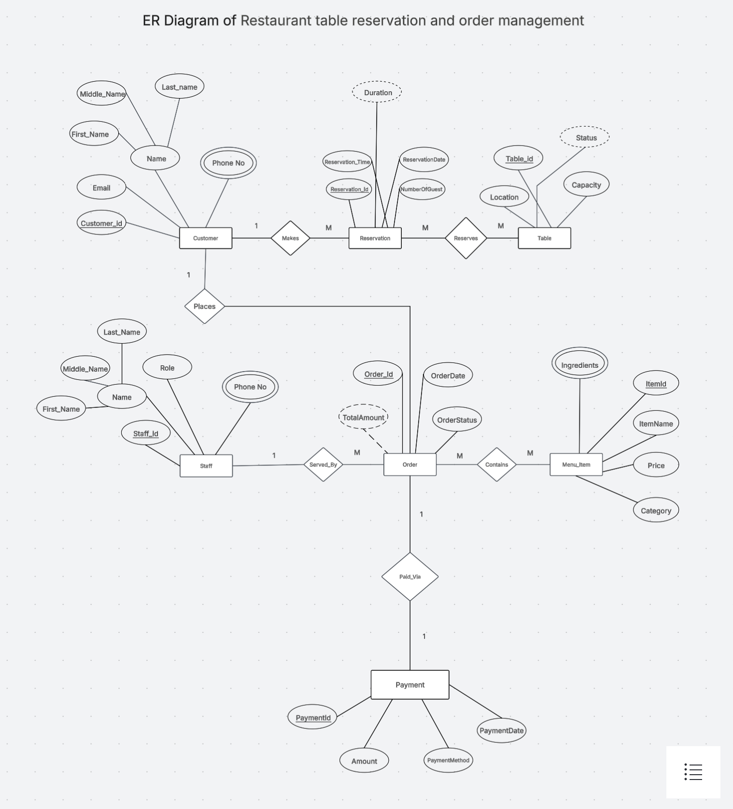

# 🍽️ Restaurant Table Reservation and Order Management

> A Java-based restaurant management application built with **Java Swing**, **JDBC**, and **MySQL** for managing customers, tables, reservations, staff, menu items, orders, and payments.

## 📌 Overview

The **Restaurant Table Reservation and Order Management System** is a desktop-based restaurant management application developed using **Java**, **Java Swing**, **JDBC**, and **MySQL**.

The application provides a graphical interface for managing common restaurant operations such as:

- Customer information
- Restaurant tables
- Table reservations
- Staff information
- Menu items and ingredients
- Customer orders
- Order items and quantities
- Payments and billing

The project demonstrates practical concepts including **Object-Oriented Programming, JDBC database connectivity, CRUD operations, SQL, relational database design, database normalization, exception handling, and GUI development**.

## ✨ Features

### 👤 Customer Management

- Add and manage customer information
- Manage customer phone numbers
- View customer reservation history

### 🪑 Table Management

- Add and manage restaurant tables
- Track table capacity
- Track table location
- Track table availability

### 📅 Reservation Management

- Create reservations
- Store reservation date and time
- Specify number of guests
- Assign tables to reservations

### 👨‍🍳 Staff Management

- Manage staff information
- Manage staff roles
- Manage staff phone numbers

### 🍕 Menu Management

- Add and manage menu items
- Manage prices and categories
- Manage menu item ingredients

### 🛒 Order Management

- Create customer orders
- Add multiple menu items to an order
- Specify quantities
- Track order status
- Calculate order totals

### 💳 Payment Management

- Record payments
- Store payment methods
- Track payment information

## 🗂️ Database Entities

The main entities used in the system are:

```text
Customer
   │
   │ makes
   ▼
Reservation ─────── reserves ───────► Table
   │
   │ creates
   ▼
Order ───────── contains ───────────► OrderItem
                                      │
                                      │ refers to
                                      ▼
                                   MenuItem
```

### Main Entities

| Entity | Description |
|---|---|
| 👤 Customer | Stores customer details |
| 🪑 Table | Stores restaurant table information |
| 📅 Reservation | Manages table bookings |
| 🛒 Order | Stores customer orders |
| 🍕 MenuItem | Stores food/menu information |
| 📦 OrderItem | Connects orders with menu items |
| 💳 Payment | Stores payment information |

---

## 🛠️ Technologies Used

| Technology | Purpose |
|---|---|
| ☕ Java | Application development |
| 🖥️ Java Swing | Desktop graphical user interface |
| 🔌 JDBC | Java–MySQL database connectivity |
| 🗄️ MySQL | Relational database |
| 📝 SQL | Database operations |
| 📊 ER Diagram | Database design |
| 📦 Maven | Project and dependency management |
| 💡 IntelliJ IDEA | Development environment |
| 🔀 Git & GitHub | Version control and collaboration |

## 📐 ER Diagram

The project includes an **Entity Relationship Diagram (ER Diagram)** showing the relationships between customers, reservations, tables, orders, menu items, and payments.

<<<<<<< HEAD
> 📌 Add your ER diagram image here:

```markdown

=======
> 📌  ER diagram image :



```markdown
(https://lucid.app/lucidspark/060674c7-d1b9-4a25-a60a-2a604afa0eab/edit?viewport_loc=-3126%2C-632%2C6818%2C3533%2C0_0&invitationId=inv_30d0d91a-55f6-458d-8fea-13c71c27d5e8)
>>>>>>> 39ebb25e12b25f826caabdf433e869fa1228fba2
```

---

# 🗄️ Database Schema

The application uses a relational MySQL database to manage customers, restaurant tables, reservations, staff, menu items, orders, and payments.

The database schema is derived from the Entity Relationship Diagram (ER Diagram).

---

## 1. Customer

Stores information about restaurant customers.

| Column | Type | Key | Description |
|---|---|---|---|
| `Customer_ID` | INT | PK | Unique customer identifier |
| `First_Name` | VARCHAR | | Customer first name |
| `Middle_Name` | VARCHAR | | Optional middle name |
| `Last_Name` | VARCHAR | | Customer last name |
| `Email` | VARCHAR | | Customer email address |

---

## 2. Customer_Phone

Stores one or more phone numbers associated with a customer.

| Column | Type | Key | Description |
|---|---|---|---|
| `Customer_ID` | INT | PK, FK | References `Customer(Customer_ID)` |
| `Phone_No` | VARCHAR | PK | Customer phone number |

---

## 3. RestaurantTable

Stores information about restaurant tables.

| Column | Type | Key | Description |
|---|---|---|---|
| `Table_ID` | INT | PK | Unique table identifier |
| `Location` | VARCHAR | | Table location |
| `Capacity` | INT | | Maximum seating capacity |
| `Status` | VARCHAR | | Current table status |

---

## 4. Reservation

Stores customer reservation information.

| Column | Type | Key | Description |
|---|---|---|---|
| `Reservation_ID` | INT | PK | Unique reservation identifier |
| `Reservation_Date` | DATE | | Date of reservation |
| `Reservation_Time` | TIME | | Time of reservation |
| `Number_Of_Guests` | INT | | Number of guests |
| `Duration` | INT | | Reservation duration |
| `Customer_ID` | INT | FK | References `Customer(Customer_ID)` |

---

## 5. Reservation_Table

Junction table representing the relationship between reservations and restaurant tables.

| Column | Type | Key | Description |
|---|---|---|---|
| `Reservation_ID` | INT | PK, FK | References `Reservation(Reservation_ID)` |
| `Table_ID` | INT | PK, FK | References `RestaurantTable(Table_ID)` |

**Composite Primary Key:**
(Reservation_ID, Table_ID)

---

## 6. Staff

Stores information about restaurant staff.

| Column | Type | Key | Description |
|---|---|---|---|
| `Staff_ID` | INT | PK | Unique staff identifier |
| `First_Name` | VARCHAR | | Staff first name |
| `Middle_Name` | VARCHAR | | Optional middle name |
| `Last_Name` | VARCHAR | | Staff last name |
| `Role` | VARCHAR | | Staff role |

---

## 7. Staff_Phone

Stores phone numbers associated with staff members.

| Column | Type | Key | Description |
|---|---|---|---|
| `Staff_ID` | INT | PK, FK | References `Staff(Staff_ID)` |
| `Phone_No` | VARCHAR | PK | Staff phone number |

---

## 8. Menu_Item

Stores restaurant menu item information.

| Column | Type | Key | Description |
|---|---|---|---|
| `Item_ID` | INT | PK | Unique menu item identifier |
| `Item_Name` | VARCHAR | | Menu item name |
| `Price` | DECIMAL | | Menu item price |
| `Category` | VARCHAR | | Menu item category |

---

## 9. Menu_Item_Ingredients

Stores ingredients associated with menu items.

| Column | Type | Key | Description |
|---|---|---|---|
| `Item_ID` | INT | PK, FK | References `Menu_Item(Item_ID)` |
| `Ingredient` | VARCHAR | PK | Ingredient name |

---

## 10. Orders

Stores customer order information.

| Column | Type | Key | Description |
|---|---|---|---|
| `Order_ID` | INT | PK | Unique order identifier |
| `Order_Date` | DATE | | Order date |
| `Order_Status` | VARCHAR | | Current order status |
| `Total_Amount` | DECIMAL | | Total order amount |
| `Customer_ID` | INT | FK | References `Customer(Customer_ID)` |
| `Staff_ID` | INT | FK | References `Staff(Staff_ID)` |

---

## 11. Order_Contains

Junction table connecting orders with menu items.

| Column | Type | Key | Description |
|---|---|---|---|
| `Order_ID` | INT | PK, FK | References `Orders(Order_ID)` |
| `Item_ID` | INT | PK, FK | References `Menu_Item(Item_ID)` |
| `Quantity` | INT | | Quantity ordered |

**Composite Primary Key:**
(Order_ID, Item_ID)

---

## 12. Payment

Stores payment information associated with orders.

| Column | Type | Key | Description |
|---|---|---|---|
| `Payment_ID` | INT | PK | Unique payment identifier |
| `Amount` | DECIMAL |  | Payment amount |
| `Payment_Method` | VARCHAR |  | Payment method |
| `Payment_Date` | DATE |  | Payment date |
| `Order_ID` | INT | FK, UNIQUE | References `Orders(Order_ID)` |

---
## 🔗 Database Relationships

| Relationship | Cardinality | Implementation |
|---|---|---|
| Customer → Reservation | 1:M | `Reservation.Customer_ID` |
| Customer → Customer_Phone | 1:M | `Customer_Phone.Customer_ID` |
| Reservation ↔ RestaurantTable | M:N | `Reservation_Table` |
| Staff → Staff_Phone | 1:M | `Staff_Phone.Staff_ID` |
| Customer → Orders | 1:M | `Orders.Customer_ID` |
| Staff → Orders | 1:M | `Orders.Staff_ID` |
| Menu_Item → Menu_Item_Ingredients | 1:M | `Menu_Item_Ingredients.Item_ID` |
| Orders ↔ Menu_Item | M:N | `Order_Contains` |
| Orders → Payment | 1:1 | `Payment.Order_ID` |

---
## 📊 Database Tables Overview

| Table | Purpose |
|---|---|
| `Customer` | Stores customer information |
| `Customer_Phone` | Stores customer phone numbers |
| `RestaurantTable` | Stores restaurant table information |
| `Reservation` | Stores customer reservations |
| `Reservation_Table` | Connects reservations with tables |
| `Staff` | Stores staff information |
| `Staff_Phone` | Stores staff phone numbers |
| `Menu_Item` | Stores menu item information |
| `Menu_Item_Ingredients` | Stores menu item ingredients |
| `Orders` | Stores customer orders |
| `Order_Contains` | Connects orders with menu items |
| `Payment` | Stores payment information |

---

## 📂 Project Structure

The project contains the database scripts, ER diagram, Java application, and project documentation.

```text
Restaurant-Table-Reservation-and-Order-Management/
│
├── ER-Diagram/
│   └── restaurant-er-diagram.png
│
├── SQL/
│   ├── create_database.sql
│   ├── create_tables.sql
│   ├── insert_data.sql
│   └── queries.sql
│
├── src/
│   └── ...
│
├── README.md
└── LICENSE
```


## 🚀 Getting Started

### 1️⃣ Clone the Repository

```bash
git clone https://github.com/your-username/Restaurant-Table-Reservation-and-Order-Management.git
```

### 2️⃣ Open MySQL

Open **MySQL Workbench**, MySQL CLI, or another SQL client.

### 3️⃣ Create the Database

Run the database creation script:

```sql
CREATE DATABASE restaurant_management;
```

### 4️⃣ Select the Database

```sql
USE restaurant_management;
```

### 5️⃣ Run the SQL Files

Execute the table creation, data insertion, and query scripts in the appropriate order.

---

## 📊 Example Operations

The database supports operations such as:

```sql
-- View available tables
SELECT *
FROM RestaurantTable
WHERE status = 'Available';
```

```sql
-- View customer reservations
SELECT *
FROM Reservation
WHERE customer_id = 1;
```

```sql
-- View orders
SELECT *
FROM Orders;
```

---

## 🎯 Project Objectives

The main objectives of this project are:

- Understand **database design**
- Implement **relationships between entities**
- Practice **SQL queries**
- Learn **primary keys and foreign keys**
- Understand **normalization**
- Manage restaurant reservations and orders efficiently
- Design a real-world database management system

---

## 🔮 Future Improvements

Some possible future improvements include:

- 🌐 Web-based restaurant management interface
- 📱 Mobile application
- 🔐 User authentication
- 💳 Online payment integration
- 📧 Reservation confirmation emails
- 📈 Restaurant analytics dashboard
- 🔔 Real-time table availability
- 🤖 AI-based food recommendations

---

## 👨‍💻 Contributors

| Name                 | Role |
|----------------------|---|
| **Soham Pachakatte** | Developer |
| **Ayush Suravanshi** | Developer |
| **Niraj Singh**      | Developer |

Want to contribute? Feel free to **fork this repository**, make your changes, and submit a **Pull Request**.

---

## ⭐ Support

If you find this project useful, consider giving the repository a **⭐ Star**!

---

## 📄 License

This project is created for **educational and academic purposes**.

---

### 🍽️ Restaurant Management Made Simple

**Reserve • Order • Manage • Serve**
